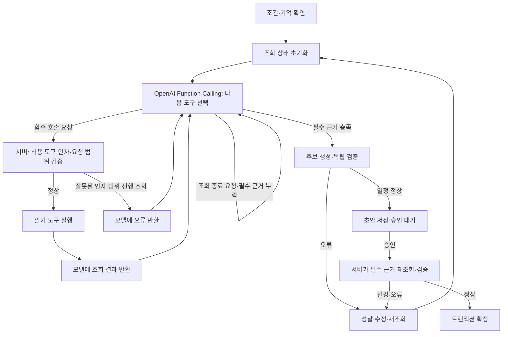

# OpenAI 도구 선택과 LangGraph 통합

## 변경된 흐름



입력 부족 시 추가 질문과 interrupt/resume, 추천 결과 반환, 거절·취소 시 기존 일정 유지는 기존 그래프와 같습니다. 성찰의 재생성 전략은 후보 생성으로, 재조회 전략은 새 계획 주기로 이동합니다. 도구 선택 한도 초과 시 실패 종료하며 일정은 반영하지 않습니다.

## 책임

- `providers.py`: 실제 Responses API `tools`·`tool_choice=auto` 사용. 도구 결과를 받은 뒤 다음 호출 또는 조회 종료를 선택합니다.
- `tool_registry.py`: 다섯 가지 읽기 도구의 설명·strict 인자 스키마·의도별 허용 범위. 현재 모임·축제·날짜와 다른 값, 임의 URL·SQL·사용자 ID는 받지 않습니다.
- `graph.py`: 선택·실행 순환, function_call_output 피드백, 필수 조회 누락 감지, 승인 후 재검증.
- `policy.py`의 `required_tools`: 생성 전에 필요한 최소 근거를 정의합니다. OpenAI의 실행 순서를 미리 정하는 함수가 아닙니다.
- `tools.py`: 검증된 읽기 도구만 실행합니다. 저장·승인은 모델 도구로 노출하지 않습니다.

선택 기록은 응답의 `trace`, 실제 호출·인자·오류·출처는 `toolCalls`와 `sources`에서 확인합니다. 모델이 응답한 비공개 추론은 API 응답에 노출하지 않습니다.

## 설정과 호환

- 기존 `AGENT_MODEL_PROVIDER=openai`, `OPENAI_API_KEY`, `OPENAI_MODEL`을 그대로 사용합니다.
- `.env` 수정 없이 계획 주기당 `AGENT_MAX_TOOL_ROUNDS=8`, `AGENT_MAX_TOOL_CALLS=12` 기본값이 적용됩니다.
- 논리적 함수 요청과 통신 재시도를 구분합니다. 통신 재시도는 기존 `AGENT_TOOL_RETRIES` 설정, 전체 수정은 `AGENT_MAX_ITERATIONS`로 제한합니다.
- 승인 시 축제·참여자·날씨 조회는 서버가 강제로 수행하며 모델이 생략할 수 없습니다.
- 규칙 기반 모드는 오프라인 시험용으로 유지합니다. OpenAI 실패 시 규칙 모드로 자동 전환하지 않습니다.
- 기존 API 경로·인증·일정 DB 트랜잭션은 유지합니다. 추가 SQL·라이브러리는 없습니다.

## 시험 결과 (2026-11-15)

전체 테스트: **48 passed, 4 skipped**. DB 통합 테스트는 별도 TEST_AGENT_DATABASE_URL이 없어 미실행입니다.

### 통제된 Function Calling 시험

- 실제 provider의 Function Calling 요청·응답 직렬화와 call_id별 결과 반환.
- 도구 결과를 확인한 뒤 추가 도구 선택, 매칭 시 선택적 날씨 조회.
- 미허용 도구·잘못된 JSON·인자 누락·다른 모임/축제/날짜·선행 조회 누락 거부 후 수정.
- 필수 근거 없는 완료 요청 재선택, 선택·호출 한도 초과 실패 종료.
- 모델 응답 미완료 시 실패 종료.
- 승인 후 강제 조회, 참여자 조건 변경 시 새 초안·새 승인.
- 기존 추가 질문·거절·취소·권한·기억·중복 승인·재시작 복구 회귀 시험.

### 실제 OpenAI 시험

모델: `gpt-5.4-mini`. 실제 API 호출 **8회 모두 성공**.

```text
조건 해석
→ get_festival 선택·결과 확인
→ get_availability 선택·결과 확인
→ get_weather 선택·결과 확인
→ 조회 종료 판단
→ 일정 생성·독립 검증
→ 승인 대기 (기존 일정 유지)
→ 승인 후 서버 재조회·재검증
→ 완료 (시험 일정 버전 1 → 2)
```

추가 질문 대기·취소, 중복 승인 거부와 실제 모델의 수정 전략 생성도 확인했습니다. 원문 실행 기록·호출 인자·선택 라운드·출처·사용량은 [실행 결과 JSON](agent-tool-calling-live-test.json)에 있습니다.

## 미검증 범위

실제 OpenAI 시험은 합성 데이터·주입한 테스트 저장소·서명된 시험 JWT·고정 날씨를 사용했습니다. 공유 Supabase 데이터와 스키마는 수정하지 않았습니다. 실제 Supabase 로그인+RLS, 실제 축제·날씨 API와 프론트 연동, 실제 모델의 성찰 전후 성능 비교는 후속 과제입니다. 통제된 시험 결과를 실제 서비스 성능 수치로 해석하지 않습니다.

## 실행

```powershell
uv run python -m pytest tests -q
uv run python -m app --reload --host 127.0.0.1 --port 8000
```

기존 서버를 사용 중이면 재시작한 뒤 인증 토큰으로 `/api/v1/agents/runs`를 호출하고, 응답의 `choose_tools` 기록과 `toolCalls.selectedBy`를 확인합니다.
