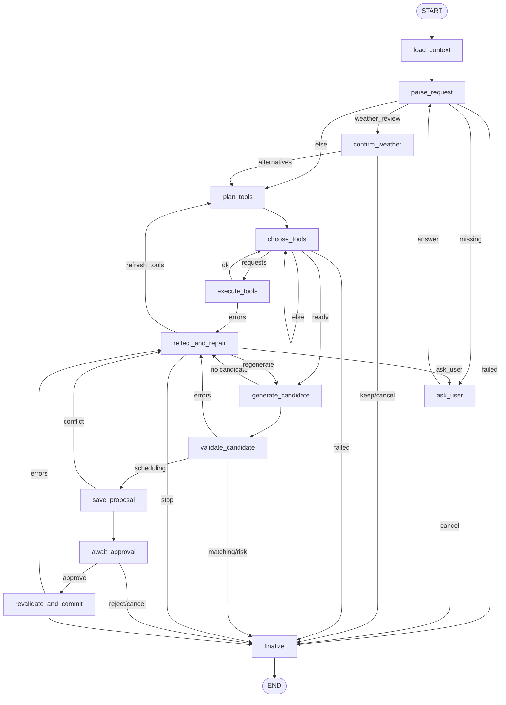
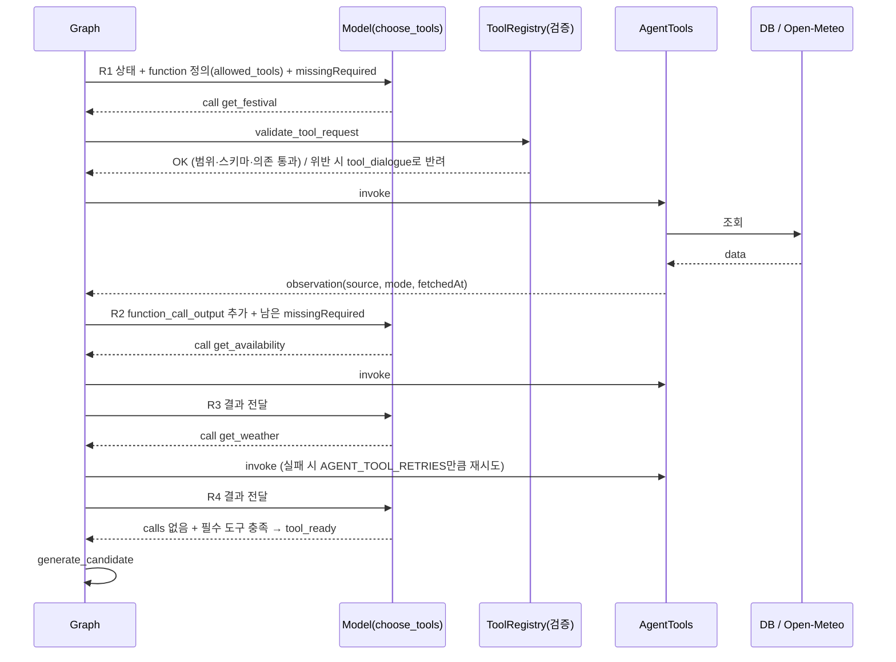
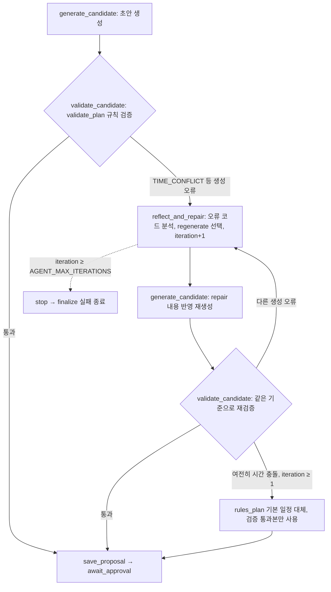
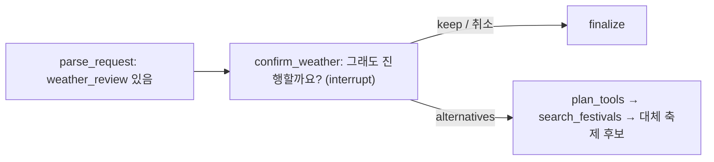

# 페스로움(Fesroam) 에이전트 아키텍처 설계서 (v0.2)

> 작성 기준: 제출 저장소 [encore-ai-campus/aio-03-p2-team2](https://github.com/encore-ai-campus/aio-03-p2-team2)의 `backend/app/features/agents/` (원본 Backend `main` 1a8b875와 동일) 코드 직접 확인 · 그래프 분기는 `graph.py` `build_graph`와 대조 완료
> 2차 검증: 11/19 독립 검증으로 상태·노드·도구·기억·재시도 설명을 코드와 대조하고 불일치를 수정함

## 1. 개요
- 프레임워크: **LangGraph StateGraph** (`graph.py` `build_graph`) + **AsyncPostgresSaver** 체크포인터(Supabase PostgreSQL `agent_storage` 스키마)
- 의도(intent) 3종: `scheduling`(모임 일정 생성) · `matching`(동행 추천) · `risk_response`(날씨 위험 → 대체 축제)
- 모델 제공자: `AGENT_MODEL_PROVIDER = rules | openai` (기본 rules). openai 모드는 Function Calling으로 도구 선택(`selection_mode=openai_function_calling`), rules 모드는 필수 도구를 규칙으로 선택(통제 실험용)
- 사람 개입(Human-in-the-loop): `interrupt()` 3곳 — `ask_user`(조건 부족), `confirm_weather`(비 예보 진행 여부), `await_approval`(일정 승인). **사람 개입은 자가 성찰과 별개**이며, 자가 성찰은 `validate_candidate → reflect_and_repair → 재실행 → 재검증` 루프를 뜻함(8장)

## 2. 상태 객체 (AgentState, `state.py`)
| 구분 | 필드 | 타입 | 초기값 | 갱신 노드 | 읽는 노드 |
|---|---|---|---|---|---|
| 식별 | run_id, session_id, user_id | str | 요청 시 서비스가 설정 | — | 전체 |
| 입력 | message | str | 사용자 입력 | ask_user | parse_request, finalize |
| 입력 | intent | str | `auto` 또는 지정 | parse_request | 대부분(분기) |
| 입력 | group_id / festival_id | str\|None | 요청값 | parse_request, ask_user | 도구·검증 |
| 조건 | conditions | dict | 요청 조건 | load_context(기억 병합), parse_request, ask_user | 도구·생성·검증 |
| 조건 | explicit_conditions | dict | 요청 conditions(구조화 입력) | ask_user(답변 병합) | parse_request(최우선 병합) |
| 맥락 | context | dict | — | load_context | parse_request(모델 입력) |
| 맥락 | requester | dict\|None | None | parse_request(DB 프로필) | 매칭 생성 |
| 맥락 | group | dict\|None | None | parse_request, plan_tools | save_proposal |
| 흐름 | missing | list[str] | [] | parse_request | ask_user, 분기 |
| 도구 | tools | list[str] | [] | plan_tools, choose_tools | trace |
| 도구 | tool_requests | list[dict] | [] | choose_tools / execute_tools(비움) | execute_tools, 분기 |
| 도구 | tool_results | dict | {} | plan_tools(초기화), execute_tools | 생성·검증·재검증 |
| 도구 | tool_dialogue | list[dict] | [] | choose_tools, execute_tools | 모델(Function Calling 대화) |
| 도구 | tool_round | int | 0 | choose_tools(+1), plan_tools(초기화) | 한도 판정(TOOL_SELECTION_LIMIT) |
| 도구 | tool_call_count / tool_attempts | int | 0 | execute_tools, plan_tools(초기화) | 한도 판정(TOOL_CALL_LIMIT)·통신 재시도 기록 |
| 도구 | tool_selected_by | str | 없음 | revalidate_and_commit(`server_approval_revalidation`) | execute_tools(toolCalls.selectedBy) |
| 도구 | tool_ready | bool | False | choose_tools | 분기 → generate_candidate |
| 도구 | tool_calls | list[dict] | [] | execute_tools | 실행 기록(감사) |
| 생성 | candidate | dict\|None | None | generate_candidate, validate_candidate(기본 일정 대체) | 검증·저장·승인 |
| 생성 | candidate_history | list[dict] | [] | validate_candidate | 시험 보고서(성찰 전/후) |
| 성찰 | errors | list[dict] | [] | 거의 모든 노드 | 분기, reflect |
| 성찰 | repair | dict | {} | reflect_and_repair | 분기, 재생성 입력 |
| 성찰 | iteration | int | 0 | reflect_and_repair(+1) | 한도·기본 일정 대체 조건 |
| 승인 | proposal_id, base_version, base_group_version | str/int | None | save_proposal | await_approval, revalidate |
| 승인 | approval | str\|None | None | await_approval | 분기 |
| 날씨 | weather_review / weather_decision | dict / str | 요청 시 / None | confirm_weather | 분기 |
| 위험 | target_festival_id, original_schedule | str / dict | 요청 시 | — | parse_request, save_proposal |
| 결과 | status | str | running | 여러 노드 | 분기, finalize |
| 결과 | result | dict\|None | None | confirm_weather, revalidate, finalize | 응답 |
| 추적 | trace | list[dict] | [] | 모든 노드(`update()`) | `GET /agents/runs/{id}` |

## 3. 노드 14개
| # | 노드 | 역할 | 입력 | 출력 | 다음 노드(조건) |
|---|---|---|---|---|---|
| 1 | load_context | 세션·장기 선호 로드, 조건 병합 | session_id, user_id | context, conditions | parse_request |
| 2 | parse_request | 모델로 의도·조건 추출, 스키마 검증, 권한·누락 확인 | message, context | intent, conditions, missing, group, requester | 실패→finalize / missing→ask_user / weather_review→confirm_weather / 그 외→plan_tools |
| 3 | ask_user | 누락 항목 질문(interrupt) | missing, errors | 보완 조건 | 취소→finalize / 그 외→parse_request |
| 4 | confirm_weather | 비 예보 시 유지/대체 선택(interrupt), 버전 충돌 검사 | weather_review | weather_decision | alternatives→plan_tools / keep·취소→finalize |
| 5 | plan_tools | 도구 상태 초기화, 모임장 권한 재확인 | group_id | 빈 tool_* | choose_tools |
| 6 | choose_tools | 모델이 다음 호출할 도구 결정, 필수 도구 누락 피드백 | tool_dialogue, tool_results | tool_requests, tool_ready | 실패→finalize / 요청 있음→execute_tools / ready→generate_candidate / 그 외→choose_tools |
| 7 | execute_tools | 인자 검증 → 호출 → 통신 재시도 → 결과 기록 | tool_requests | tool_results, tool_calls, errors | errors→reflect_and_repair / 그 외→choose_tools |
| 8 | generate_candidate | 일정·매칭·대체 축제 후보 생성 | conditions, tool_results | candidate | 후보 없음→reflect / 그 외→validate_candidate |
| 9 | validate_candidate | 규칙 검증(`validate_plan`), 2회차부터 시간 충돌 시 기본 일정 대체 | candidate, tool_results | errors, candidate_history | errors→reflect / scheduling→save_proposal / 그 외→finalize |
| 10 | reflect_and_repair | 오류 코드로 수정 전략 결정, iteration+1 | errors, iteration | repair.action | stop→finalize / ask_user / refresh_tools→plan_tools / regenerate→generate_candidate |
| 11 | save_proposal | 제안 저장(버전 기록) | candidate, group | proposal_id, base_*version | 버전 충돌→reflect / 그 외→await_approval |
| 12 | await_approval | 모임장 승인 대기(interrupt) | proposal_id, candidate | approval | approve→revalidate_and_commit / reject·cancel→finalize |
| 13 | revalidate_and_commit | 필수 도구 재조회·재검증 후 확정(체크포인트 데이터 불신) | candidate, base_*version | result | errors→reflect / 그 외→finalize |
| 14 | finalize | 상태 확정, 미승인 제안 반려, 세션 기억 저장 | status, result | 최종 result | END |

## 4. 도구 5개
| 도구 | 조회 대상 | 인자(strict) | 허용 의도 | 필수 조건 | 선행 의존 |
|---|---|---|---|---|---|
| get_festival | 축제 기간·운영시간·장소·취소 상태 | festival_id | 전체 | 전 의도 필수 | — |
| get_availability | 모임 참여자 가능 시간 | group_id | scheduling | scheduling 필수 | — |
| get_candidates | 동행 후보(최대 50, 요청자·시간 불가 제외) | festival_id | matching | matching 필수 | — |
| get_weather | 축제 좌표·모임 시간대 시간별 예보(Open-Meteo/demo) | festival_id, date | 전체 | scheduling·risk 필수, matching은 avoid_rain 시 | get_festival (+scheduling은 get_availability) |
| search_festivals | 요청일에 열리는 미취소 대체 축제 | date | 전체 | risk_response 필수 | — |

서버 통제(`tool_registry.validate_tool_request`): 허용 목록 외 도구 → `TOOL_NOT_ALLOWED`, 스키마 위반 → `TOOL_ARGUMENTS_INVALID`, 현재 요청과 다른 ID·날짜 → `TOOL_SCOPE_MISMATCH`, 순서 위반 → `TOOL_DEPENDENCY_MISSING`. 이 4종은 errors에 넣지 않고 tool_dialogue로 모델에 되돌려 다음 라운드에서 스스로 고치게 함.

### 4-1. 도구 필요 여부·데이터 충분성 판단 정책
- **의도 판단**: parse_request가 intent(`auto`면 모델 추출)를 정하고, 의도별 허용 도구(`allowed_tools`)만 모델에 제공
- **데이터 충분성**: 날짜·축제·모임 등 필수 조건이 없으면 `missing`에 담아 **도구를 부르기 전에** ask_user로 질문
- **도구 필요 여부**: 의도별 필수 도구(위 표)를 서버가 정하고, choose_tools가 `missingRequired`로 남은 필수 도구를 모델에 피드백
- **실행 준비 완료(`tool_ready`)**: 대기 중인 도구 요청이 없고 필수 도구 결과가 모두 있을 때만 generate_candidate로 이동
- OpenAI 호출은 `parallel_tool_calls=False` → **라운드마다 도구 1개**. rules 모드는 R1에 필수 도구를 한 번에 선택

## 5. 기억 구조
| 구분 | 저장소 | 내용 | 읽기/쓰기 시점 |
|---|---|---|---|
| 실행 상태(단기) | `agent_storage.checkpoints*` (AsyncPostgresSaver) | 노드 단위 AgentState 스냅샷 | 매 노드 저장, interrupt 후 resume 시 복원(checkpoint_id 일치 검사, 프로세스 간 resume 락) |
| 세션 기억(단기) | `agent_storage.sessions` | summary, 최근 messages 6개, conditions | load_context 읽기 / finalize 쓰기 |
| 장기 선호 | `agent_storage.preferences` | 사용자별 장기 선호(사용자가 `remember`로 확인한 선호, JSON 병합) | load_context 읽기 / 요청 payload.remember 시 쓰기 / 조회 API `GET /api/v1/agents/preferences` |
| 실행 기록 | `agent_storage.executions` | run 상태·proposal_id | 실행 시작·갱신, `GET /agents/runs/{id}` |

- 조건 우선순위: 장기 선호 < 세션 조건 < 모델 추출 < 명시 입력(`explicit_conditions` = 요청의 구조화 조건 + ask_user 답변). 예: 장기 선호 "야외 선호"보다 이번 요청 "실내만"이 우선
- 컨텍스트 윈도우: 최근 메시지 **6개**·각 500자 제한으로 모델 입력 크기 고정
- 요약 전략: `summary`는 **구조화 요약**(조건·마지막 의도·상태)으로 저장하고 최근 메시지 6개를 유지함. **별도 LLM 요약 호출은 없음**(9장 한계)
- 요청자 성별·연령은 장기 기억이 아니라 `repository.user()` 사용자 프로필에서 읽음

## 6. 오류 처리·재시도
**두 종류 재시도를 분리**
| 구분 | 설정(기본값) | 대상 | 위치 |
|---|---|---|---|
| 통신 재시도 | `AGENT_TOOL_RETRIES=2` (0~4) | retryable=True 오류(네트워크, 기상 API 5xx·429) | execute_tools 내부 루프, 0.05s·0.10s 백오프 |
| 판단 재실행(성찰) | `AGENT_MAX_ITERATIONS=3` (1~8) | 검증 실패·도구 실패 | reflect_and_repair, 초과 시 stop |
| 도구 선택 라운드 | `AGENT_MAX_TOOL_ROUNDS=8` (2~16) | choose_tools 반복 | 초과 시 `TOOL_SELECTION_LIMIT` → 바로 finalize(실패) |
| 도구 호출 총량 | `AGENT_MAX_TOOL_CALLS=12` (3~32) | 1회 실행 내 호출 수 | 초과 시 `TOOL_CALL_LIMIT` |

**오류 유형별 판정·대체 전략** (`reflect` 규칙 판정. openai 모드도 규칙 판정을 먼저 적용하고, 규칙 결과가 regenerate일 때만 모델이 `RepairDecision`으로 4개 전략 중 하나를 고름. 허용 외 값은 stop)
| 전략 | 오류 코드 | 판정 이유 |
|---|---|---|
| ask_user | WEATHER_RISK, VENUE_UNCONFIRMED, OPERATING_HOURS_MISSING, AVAILABILITY_MISSING, SCHEDULE_WINDOW_EMPTY, WEATHER_DATE_UNAVAILABLE, WEATHER_LOCATION_MISSING | 사용자 조건을 임의로 완화하지 않음 |
| refresh_tools | TOOL_NETWORK_ERROR(재시도 소진), TOOL_RESPONSE_INVALID, RESOURCE_VERSION_CONFLICT | 최신 데이터로 다시 계획 |
| stop | FESTIVAL_UNAVAILABLE, MODEL_UNAVAILABLE(생성·성찰 단계), TOOL_CALL_LIMIT | 해결 불가 설정·데이터 |
| regenerate | 위 목록에 없는 모든 코드(기본값). 예: TIME_CONFLICT, WEATHER_TIME_CONFLICT, DATE_MISMATCH, TIMELINE_ORDER, UNGROUNDED_CANDIDATE, CANDIDATE_INVALID | 생성 결과 문제 → 오류 내용을 넣어 재생성 |
| 최후 대체 | iteration≥1 이후에도 TIME_CONFLICT·WEATHER_TIME_CONFLICT | 검증 통과한 규칙 기반 기본 일정(`rules_plan`)으로 대체 (BE #24 성찰 우선) |

- reflect를 거치지 않는 종료: parse_request·choose_tools의 모델 호출 실패(MODEL_UNAVAILABLE)와 TOOL_SELECTION_LIMIT는 `status=failed`로 바로 finalize

**판단 오류 4유형 판정 기준**
| 유형 | 감지 위치 | 판정 기준(오류 코드) | 수정 전략 |
|---|---|---|---|
| 할루시네이션 | validate_candidate(`validate_plan`) | 도구 결과에 없는 장소·후보·시간 사용 → UNGROUNDED_CANDIDATE | regenerate |
| 도구 선택 오류 | tool_registry, choose_tools | 허용 외 도구 TOOL_NOT_ALLOWED, 선행 도구 누락 TOOL_DEPENDENCY_MISSING, 필수 도구 미선택(`missingRequired`) | tool_dialogue·missingRequired로 모델에 되돌려 다음 라운드에서 수정 |
| 파라미터 누락·오류 | parse_request, tool_registry | 사용자 필수 조건 누락 → `missing`, 스키마 위반 TOOL_ARGUMENTS_INVALID, 요청과 다른 ID·날짜 TOOL_SCOPE_MISMATCH | 누락 → ask_user / 인자 오류 → 모델 재선택 |
| 응답 불일치 | validate_candidate | 요청 조건과 결과 불일치 → TIME_CONFLICT, DATE_MISMATCH, TIMELINE_ORDER, WEATHER_TIME_CONFLICT | regenerate → (시간 충돌 지속 시) rules_plan |

**오류 유형별 재시도 횟수**
| 유형 | 자동 재시도 | 한도 초과 시 |
|---|---|---|
| 통신 실패(retryable) | execute_tools 내부 최대 `AGENT_TOOL_RETRIES`(2)회 → 소진 시 refresh_tools | `AGENT_MAX_ITERATIONS` 도달 → stop(임의 값 대체 금지) |
| 생성 결과 오류 | regenerate, `AGENT_MAX_ITERATIONS`(3)까지 | 시간 충돌은 iteration≥1부터 rules_plan, 그 외는 stop |
| 도구 선택·인자 오류 | 라운드마다 모델 재선택, `AGENT_MAX_TOOL_ROUNDS`(8)·`AGENT_MAX_TOOL_CALLS`(12)까지 | TOOL_SELECTION_LIMIT / TOOL_CALL_LIMIT → 실패 종료 |
| 사용자 조건 부족·위험(ask_user 코드) | 자동 재실행 0회 | 사용자 답변 후 parse_request부터 재개 |

안전장치: 승인 후 `revalidate_and_commit`이 필수 도구를 서버가 직접 재조회(`server_approval_revalidation`)하고, 모임·일정 버전이 바뀌면 제안 반려 후 재제안 요구.

## 7. 대표 요청 추적
### 7-1. 실제 실행: 매칭 (배포 서버, OpenAI Function Calling)
기록: [`docs/runs/matching-run.json`](runs/matching-run.json) · `run_a988b28c129a403db61531f1ee93d677` · 조건 date 2026-11-22, start_time 15:00
| 순서 | 노드 | 실제 상태 변화(trace·toolCalls) | 담당 |
|---|---|---|---|
| 1 | load_context | 세션·장기 선호 로드 | 기억 |
| 2 | parse_request | intent=matching, conditions={date, start_time} 추출 | 입력 |
| 3 | plan_tools | tools=[] 초기화 | 도구 |
| 4 | choose_tools R1 | 모델 선택 `get_festival` / missingRequired=[get_festival, get_candidates] | 판단 |
| 5 | execute_tools | get_festival ok (festival_repository, attempt 1) | 행동 |
| 6 | choose_tools R2 | 모델 선택 `get_candidates` / missingRequired=[get_candidates] | 판단 |
| 7 | execute_tools | get_candidates ok (user_profiles, attempt 1) | 행동 |
| 8 | choose_tools R3 | 요청 없음, missingRequired=[] → tool_ready | 판단 |
| 9 | generate_candidate | 동행 후보 5명 | 생성 |
| 10 | validate_candidate | errorCodes=[] | 검증 |
| 11 | finalize | status=completed, 세션 기억 저장 | 결과 |

### 7-2. 일정 생성 흐름 (scheduling, 승인 포함 설계 경로)
요청 예: "토요일 오후에 ○○축제 모임 일정 짜줘" (모임장, group_id 지정)
| 순서 | 노드 | 주요 상태 변화 |
|---|---|---|
| 1 | load_context | context(선호·최근 6메시지), conditions 병합 |
| 2 | parse_request | intent=scheduling, date 추출, group 로드, missing=[] |
| 3 | plan_tools | tool_* 초기화 |
| 4 | choose_tools R1 → execute_tools | get_festival (OpenAI 모드는 라운드당 1개) |
| 5 | choose_tools R2 → execute_tools | get_availability |
| 6 | choose_tools R3 → execute_tools | get_weather (선행: get_festival·get_availability) |
| 7 | choose_tools R4 | 요청 없음 + 필수 충족 → tool_ready |
| 8 | generate_candidate | candidate(일정 items) |
| 9 | validate_candidate | errors=[] |
| 10 | save_proposal | proposal_id, base_version |
| 11 | await_approval | interrupt → approve |
| 12 | revalidate_and_commit | 3개 도구 서버 재조회·재검증 → 확정 |
| 13 | finalize | status=completed, 세션 저장 |

rules 모드는 R1에서 필수 도구 3개를 한 번에 고르고 R2에서 tool_ready가 됩니다([통제 실험 기록](runs/repair-time-conflict.json)). 이 표는 설계 경로이며, 실제 OpenAI 실행 기록은 7-1(매칭)입니다.

## 8. 대표 오류: 시간 충돌 감지 → 성찰 → 재생성 (Activity)
자가 성찰 = **오류 감지 → 원인 분석 → 수정 전략 선택 → 재실행 → 검증**

| 단계 | 노드 | 입력 | 출력(상태 기록) |
|---|---|---|---|
| 오류 감지 | validate_candidate | candidate, conditions, tool_results | errors(code=TIME_CONFLICT 등), candidate_history에 수정 전 초안 |
| 원인 분석·전략 선택 | reflect_and_repair | errors, iteration | repair.action=regenerate, repair.reason, iteration+1 |
| 재실행 | generate_candidate | conditions, tool_results, repair | 새 candidate |
| 검증 | validate_candidate | 새 candidate | errors=[] → save_proposal, candidate_history에 수정 후 초안 |

실제 기록([`docs/runs/repair-time-conflict.json`](runs/repair-time-conflict.json), 통제 실험 `too_early`):
`generate_candidate(it 0)` → `validate_candidate` errorCodes=[TIME_CONFLICT] → `reflect_and_repair` repair.action=regenerate → `generate_candidate(it 1)` → `validate_candidate` errorCodes=[] → `save_proposal` (판단 재실행 1회, 통신 재시도 0회)

### 8-1. 비 예보 확인은 사람 결정(HITL)이며 자가 성찰과 구분

- `graph.py` `build_graph`: parse_request는 `weather_review`가 있으면 confirm_weather로, confirm_weather는 `weather_decision == "alternatives"`일 때만 plan_tools로 이동
- 날씨 판정: 강수확률 ≥60% 또는 악천후 코드(65,67,75…99) → 위험, 약한 비 코드 포함 시 confirm_weather 질문
- 검증 중 비 회피 조건과 충돌(WEATHER_RISK)하면 성찰이 `ask_user`를 선택해 사용자에게 다시 물음(조건을 임의로 완화하지 않음)

## 9. 한계
- LLM 기반 대화 요약 미구현(구조화 요약 + 최근 6메시지 유지, 별도 LLM 요약 호출 없음)
- 기본 모델 제공자가 rules → 시험 결과는 통제 실험과 실제 API(openai·openmeteo) 결과를 구분 표기
- 성찰 전략의 ask_user는 자동 해결이 아니라 사용자 개입에 의존
