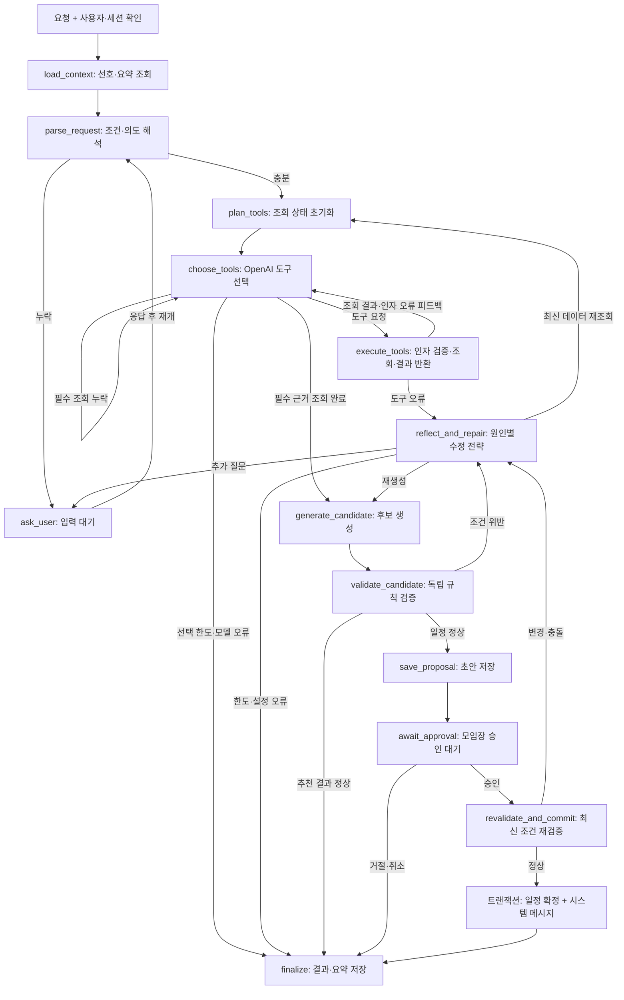

# FestaMate 에이전트 워크플로우

## 매칭 API와 에이전트의 공통 조건

`matching` 실행의 `conditions`와 입력 대기의 `answers`에 `ageBand`(`10대`~`50대`), `genderPreference`(`any`, `same`, `only_same`), `preferredMbti`를 전달할 수 있습니다. OpenAI의 구조화 조건 해석과 규칙 모드도 나이대·성별 선호를 전달합니다. 예: `30대 동성만, 오후 3시부터 동행 추천`.

요청자 본인의 나이대·성별은 인증된 사용자 ID로 DB에서 조회합니다. 입력 문장이나 모델 출력으로 본인 프로필을 덮어쓰지 않습니다. 나이대 조건을 생략하면 본인 나이대를 기준으로 계산하고, `only_same`인데 본인 성별이 없으면 `MATCHING_GENDER_REQUIRED`로 종료합니다. 프로필에 성별을 저장한 뒤 새 실행을 시작해야 합니다.

직접 매칭 API와 에이전트는 동일한 `rank_candidates`를 사용합니다. 확인된 가능 시간이 요청 시각보다 늦은 후보는 양쪽 모두 제외합니다. 가능 시간이 미입력인 후보는 미확인 상태로 표시하고, 최신 PR의 정보 충족률 50%·점수 80점 기준을 적용합니다. 실제 일정 생성·승인에서는 기존대로 모든 참여자의 가능 시간을 확인합니다. 에이전트는 전체 후보를 먼저 평가한 뒤 상위 최대 50명의 근거만 모델에 전달하므로, 조회 순서상 50번째 이후에 있는 우수 후보도 누락되지 않습니다. 기본 추천 개수 5명과 동일한 조건·프로필·후보 데이터에서 결과 순서·총점·세부 점수를 비교합니다.

```json
{
  "message": "동행 추천",
  "intent": "matching",
  "festivalId": "선택한 축제 ID",
  "conditions": {
    "date": "2030-05-10",
    "startTime": "15:00",
    "ageBand": "30대",
    "genderPreference": "only_same"
  }
}
```

회귀 테스트: `python -m pytest tests/test_agent_matching_parity.py tests/test_matching_score.py -q`. 실제 HTTP 라우트와 그래프를 사용하고 저장소는 격리합니다. OpenAI 경로는 SDK 응답을 통제하며 실제 유료 API를 호출하지 않습니다. 일정 생성·추가 질문·승인·재검증·악천후 대응의 그래프 경로는 유지합니다.

모집글·참여 승인·악천후 알림·대체 일정과 비교 응답 연결은 [전체 시나리오 호출 안내](connected-workflow.md)를 참고하세요. 매칭은 시작 시간이 누락되면 추가 질문합니다.

구현 위치: `app/features/agents/`. 기존 기능별 구조에 `agents`를 추가했습니다. API는 입출력과 권한, 에이전트는 판단과 검증, repository는 저장을 담당합니다.

## 처리 흐름



실제 그래프 Mermaid는 `GET /api/v1/agents/workflow`에서도 조회합니다. 입력 대기와 승인 대기는 LangGraph `interrupt`, 재개는 `Command(resume=...)`를 사용합니다. HTTP 연결을 유지하지 않고 체크포인트를 저장합니다.

## 책임과 파일

| 파일 | 책임 |
| --- | --- |
| `schemas.py` | 실행·재개·조건·일정 출력 스키마 |
| `state.py` | 노드 사이에 전달할 TypedDict |
| `graph.py` | 노드, 조건 분기, 성찰 루프, 승인 및 재검증 |
| `policy.py` | 최소 필수 조회, 날짜·시간·참여자·운영시간 검증 |
| `tool_registry.py` | 읽기 도구 정의·인자 스키마·현재 요청 범위 검증 |
| `providers.py` | OpenAI Function Calling·Structured Outputs, 규칙 기반 시험 모드 |
| `tools.py` | 저장소 조회, Open-Meteo, TourAPI 어댑터 |
| `memory.py` | 사용자 선호, 세션 요약, 실행 소유권 |
| `service.py` | 그래프 생명주기, 시작·조회·재개, 동시 승인 방지 |
| `router.py` | 에이전트 REST API |
| `features/schedules/repository.py` | 검증된 초안·승인 결과의 DB 트랜잭션 |

OpenAI 모드는 Responses API Function Calling으로 도구와 인자를 선택합니다. 서버가 조회 결과 또는 인자 검증 오류를 `function_call_output`으로 돌려주면 모델이 다음 도구를 선택합니다. 모델이 조회를 끝내겠다고 해도 필수 근거가 없으면 누락 목록을 전달하고 다시 선택하게 합니다.

모델은 허용된 읽기 도구만 요청할 수 있습니다. 서버가 스키마와 현재 festival_id·group_id·date를 대조하며 사용자 ID, SQL, 임의 URL, 승인·저장 도구를 모델에 제공하지 않습니다. 승인 후 재검증은 모델 선택과 별개로 축제·참여자·날씨를 반드시 새로 조회합니다.

## 상태와 기억

| 상태 | 자료형·역할 | 갱신 위치 |
| --- | --- | --- |
| `run_id`, `session_id`, `user_id` | str, 실행·대화·소유자 | service 시작 |
| `message`, `intent`, `conditions` | str/str/dict, 현재 요청 | parse_request, ask_user |
| `explicit_conditions` | dict, 구조화 입력 우선순위 보존 | service, ask_user |
| `context` | dict, 확인된 선호·대화 요약·최근 메시지 | load_context |
| `tools`, `tool_results`, `tool_calls` | list/dict/list, 선택·결과·호출 기록 | choose_tools, execute_tools |
| `tool_requests`, `tool_dialogue` | list, 함수 호출 요청·응답 연결 기록 | choose_tools, execute_tools |
| `tool_round`, `tool_call_count`, `tool_ready` | int/int/bool, 선택 한도·호출 한도·근거 충족 | plan_tools, choose_tools, execute_tools |
| `candidate`, `errors`, `repair` | dict/list/dict, 후보·위반·수정 전략 | generate, validate, reflect |
| `iteration`, `tool_attempts` | int, 판단 수정과 통신 재시도 분리 | reflect, execute_tools |
| `proposal_id`, `base_version`, `base_group_version` | 초안과 생성 기준 버전 | save_proposal |
| `approval`, `status`, `result`, `trace` | 결정·진행·결과·노드 실행 기록 | 승인·확정·finalize |

- 체크포인트: Supabase PostgreSQL의 `agent_storage.checkpoints/checkpoint_blobs/checkpoint_writes`. 공식 AsyncPostgresSaver로 실행 중 상태와 대기 지점을 저장합니다.
- 단기 기억: `agent_storage.sessions`의 세션별 조건·요약·최근 메시지 6개. 메시지는 각각 500자로 제한합니다.
- 장기 기억: `agent_storage.preferences`에 사용자가 `remember`로 명시적으로 확인한 관심사·여행 스타일·실내·우천 회피 선호만 저장합니다.
- 우선순위: 장기 선호 < 이전 세션 조건 < 현재 자연어에서 추출한 조건 < 현재 구조화 조건.
- 완료 시 조건·직전 의도·상태를 구조화 요약합니다. LLM 요약을 별도로 호출하지 않습니다.
- 이전 날씨·축제 조회 결과를 세션 선호로 재사용하지 않습니다. 매 실행과 승인 시 다시 조회합니다.
- 축제 설명은 500자, 매칭 조회는 최대 50명, 대체 축제는 최대 30개를 모델 입력에 사용합니다. 토큰 기반 압축·검색 저장소는 아직 없습니다.

## 도구와 실행 모드

| 의도 | 최소 필수 도구 | 결과 |
| --- | --- | --- |
| scheduling | get_festival, get_availability, get_weather | 일정 초안 → 승인 → 반영 |
| matching | get_festival, get_candidates, 우천 회피 시 get_weather | 가능 시간 필터 + 기존 점수 기반 후보 |
| risk_response | get_festival, get_weather, search_festivals | 대체 축제 후보 안내, 자동 모임·축제 변경 없음 |

모델은 허용된 도구 중 다음 조회를 선택하고 결과에 따라 추가 조회할 수 있습니다. 매칭에서 날씨 조회는 우천 회피 조건이 없으면 선택 사항이며, 대체 축제 검색은 관련 요청에서 추가로 선택할 수 있습니다.

각 조회에 `source`, `mode`, `fetchedAt`, 공개 API URL을 붙입니다. 비밀 키를 포함한 요청 URL은 기록하지 않습니다.

- `AGENT_MODEL_PROVIDER=rules`: 명시적인 오프라인 규칙 모델. LLM 호출이 아닙니다.
- `AGENT_MODEL_PROVIDER=openai`: 도구 선택은 OpenAI Responses Function Calling, 자연어 해석·일정 생성·성찰은 Structured Outputs를 사용합니다. 모델명과 키가 필요합니다. 매칭 점수와 대체 후보 정렬은 이 모드에서도 결정적 규칙입니다.
- `AGENT_WEATHER_PROVIDER=demo`: 강수확률 20% 고정 시험 데이터.
- `AGENT_WEATHER_PROVIDER=openmeteo`: 지정 날짜·좌표의 실제 일별 강수확률·날씨 코드를 조회합니다. 기상청 API와 다릅니다. 예보 범위 밖은 사용자에게 날짜 확인을 요청합니다.
- `TOUR_API_SERVICE_KEY`가 있으면 대체 축제 검색에 한국관광공사 TourAPI를 사용합니다. 없으면 기존 축제 저장소를 조회합니다. 상세 운영시간이 없는 대체 후보는 확정 일정으로 취급하지 않습니다.
- 일반 API와 에이전트가 같은 `DATABASE_URL`을 사용합니다. 연결 또는 추가 스키마가 없으면 시작 시 실패하며 SQLite·인메모리로 자동 전환하지 않습니다. 적용 순서는 [DB 담당자 안내](agent-postgres.md)를 확인합니다.

시간 검증은 요청 날짜·시간 범위, 모든 참여자 가능 시간, 축제 운영시간, 항목 순서·겹침, 취소 여부, 명시적 실내·우천 회피 조건을 검사합니다. 비용·이동시간·동선은 원천 데이터가 없어 검증하지 않습니다. 예산은 현재 매칭 점수에만 사용합니다.

## 성찰과 종료

| 감지 결과 | 다음 행동 |
| --- | --- |
| 시간·날짜·형식 위반 | 오류와 수정 전략을 생성 입력에 넣고 재생성 |
| 네트워크 오류·응답 불일치 | 통신 재시도 후 도구 재조회 전략 |
| 그룹·일정 버전 변경 | 기존 제안 폐기, 최신 조건 재조회, 새 초안과 새 승인 |
| 날씨 충돌·실내 정보 불명·운영시간 누락 | 사용자 추가 확인 |
| 모델·API 설정 오류·이용 불가 축제·도구 선택/호출 한도 | 실패 종료 |
| 도구 인자·허용 범위·선행 조회 오류 | 함수 호출 오류를 모델에 반환해 다음 선택에서 수정 |
| 수정 횟수 초과 | 실패 종료, 확정 일정 변경 없음 |

도구 선택은 계획 주기당 기본 8회(`AGENT_MAX_TOOL_ROUNDS`), 논리적 도구 요청은 기본 12개(`AGENT_MAX_TOOL_CALLS`)로 제한합니다. 필수 조회를 계속 누락하거나 잘못된 인자를 반복하면 한도 내에서 오류를 모델에 전달하고, 한도 초과 시 실패 종료합니다. 통신 재시도는 논리적 도구 요청과 별도로 셉니다. 재조회 전략은 새 계획 주기를 시작하며 전체 수정 횟수 상한을 함께 적용합니다.

통신 재시도 기본 2회는 동일 도구의 추가 호출 횟수입니다. 판단 수정 기본 3회는 성찰 후 다음 행동을 선택할 수 있는 횟수입니다. 환경변수로 상한을 조정합니다. 오류가 해결되지 않으면 성공으로 처리하지 않습니다.

승인 시 참여자·프로필·운영시간·날씨를 다시 읽습니다. SQL 반영은 그룹·일정 행 잠금, 기준 버전과 참여자 가능 시간 재확인, 모든 일정 항목 저장, 버전 증가, 시스템 메시지 추가를 한 트랜잭션으로 처리합니다. 처리 중 중단 후 재개할 때 이미 승인된 동일 제안은 다시 반영하지 않습니다. 외부 API의 미래 변경까지 DB와 하나의 트랜잭션으로 묶을 수는 없습니다.

## API 계약과 사용 예

모든 경로 접두어는 `/api/v1`. Supabase Auth의 `Authorization: Bearer <access-token>`이 필요합니다. 실행·세션은 사용자별로 격리하며 그룹 실행은 모임장만 가능합니다. JWT를 검증하고 `sub`와 연결된 앱 사용자 ID를 사용합니다.

| 경로 | 역할 |
| --- | --- |
| POST /agents/runs | 새 실행, optional sessionId·groupId·festivalId·conditions·remember |
| GET /agents/runs/{runId} | 상태·초안·출처·오류·노드 및 도구 호출 기록 |
| POST /agents/runs/{runId}/resume | 질문 응답 또는 승인·거절·취소 |
| GET /agents/preferences | 본인의 확인된 장기 선호 |
| GET /agents/workflow | 실제 그래프 Mermaid |

```json
{"message":"오후 3시 이후 일정을 만들어줘","intent":"scheduling","groupId":"실제 생성한 모임 ID","conditions":{"startTime":"15:00"}}
```

성공 응답의 `data.status`는 `waiting_input`, `waiting_approval`, `completed`, `failed`, `rejected`, `cancelled` 중 하나입니다. HTTP 201은 실행 생성 성공이며 에이전트 작업 완료를 뜻하지 않습니다.

```json
{"checkpointId":"직전 응답의 checkpointId","answers":{"date":"2026-11-14"},"groupId":"모임 ID"}
```

```json
{"checkpointId":"직전 응답의 checkpointId","decision":"approve"}
```

승인 단계에서는 조건 변경을 받지 않습니다. 바꾸려면 거절 후 새 실행을 시작합니다. 이전 checkpointId 재사용은 409입니다. 입력 대기에서 approve 요청으로 승인을 우회할 수 없습니다.

**기존 일정 API의 URL은 유지하되 응답 계약이 변경됩니다.** `/groups/{id}/schedule/proposals`는 단순 초안 대신 runId·checkpointId·status·candidate를 포함한 실행 객체를 반환합니다. 기존 approve/reject URL도 같은 그래프로 연결되며, 에이전트 외부에서 만든 과거 초안을 바로 승인하지 않습니다. 프론트 담당자는 대기 상태와 추가 질문 UI를 연결해야 합니다. 조회 시 일정 `items` 전체를 사용하고 `current`는 첫 항목 호환 필드로 취급합니다. 공개 모임 조회에서는 일정·참여 신청·채팅을 제외했습니다.

## 실행과 검증

```powershell
uv sync
uv run python -m app --reload --host 127.0.0.1 --port 8000
uv run python -m pytest tests/test_agent_workflow.py -q
uv run python -m scripts.agent_demo --group-id YOUR_GROUP_ID
uv run python -m scripts.evaluate_agent --output data/agent-evaluation.json
```

Swagger: http://127.0.0.1:8000/docs. Authorize에 로그인 access token을 입력합니다. 먼저 `/groups`로 모임을 생성하거나 기존 모임 ID를 사용합니다. 기본 사용자 `usr_demo_02`의 가능 시간은 13:00, `usr_demo_01`은 15:00입니다.

체크포인트·기억은 PostgreSQL에 저장하고 실행 재개는 DB advisory lock으로 여러 서버 간 충돌을 막습니다. Direct 또는 Session pooler 연결을 사용합니다. 규칙·흐름 단위 시험은 주입한 테스트 전용 InMemorySaver로 실행하며 서버의 대체 저장소가 아닙니다. 기존 SQLite 파일은 보존하지만 사용·자동 이관하지 않습니다. 원격 DB 보존·삭제 정책은 DB 담당자와 정해야 합니다.

## 팀 연동과 남은 확인

- 에이전트 담당: graph/state/policy/providers/tools/memory 및 시나리오 테스트.
- 백엔드 담당: REST 응답 계약·실제 로그인 검증·참여/리스크 이벤트에서 에이전트 실행을 시작할 시점 연결. 현재는 명시적 요청 시 실행하며 자동 감시나 백그라운드 트리거는 없습니다.
- DB 담당: 기존 테이블·타입·제약과 SQL 어댑터를 실제 DB에서 검증. Supabase DDL·RLS는 에이전트 저장 SQL과 인증 SQL을 분리해 관리합니다. 체크포인터·기억 추가 SQL 적용과 원격 연결·보존 정책을 확인해야 합니다.
- 프론트 담당: 실행 생성 → 대기·질문·승인 → 상태·출처·실패 안내 연결. 프론트 파일은 이번 작업에서 변경하지 않았습니다.
- 실제 OpenAI·TourAPI·Supabase 연결 시험, 기상 API 실환경 접속, 배포 환경의 저장소 유지와 실제 인증은 별도 확인이 필요합니다.

참고: [LangGraph interrupts](https://docs.langchain.com/oss/python/langgraph/interrupts), [persistence](https://docs.langchain.com/oss/python/langgraph/persistence), [OpenAI Structured Outputs](https://developers.openai.com/api/docs/guides/structured-outputs), [Open-Meteo](https://open-meteo.com/en/docs), [한국관광공사 국문 관광정보 서비스](https://www.data.go.kr/data/15101578/openapi.do).
